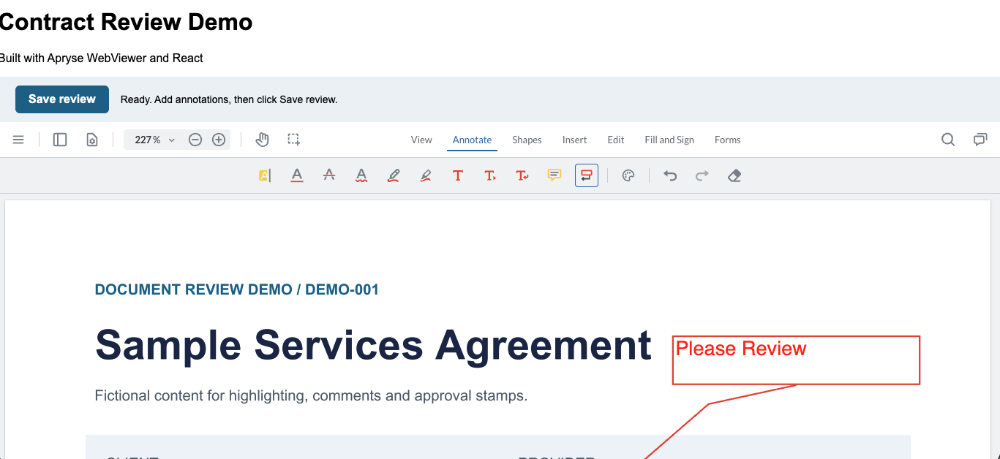
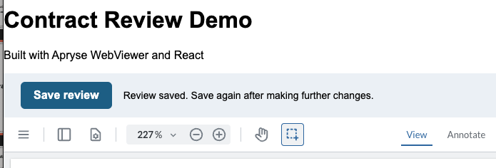

# Document Review Portal · Apryse WebViewer

A working PDF review application built with **React, Apryse WebViewer and a Node.js/Express backend**.

Review a sample agreement, highlight clauses, add comments or stamps, and save the annotations. Reopening the page restores the saved review through the application’s HTTP API.

## Demo screenshots

### Annotate the agreement

Apryse WebViewer displays the fictional agreement inside the React application. The reviewer can use the SDK’s annotation tools and the application’s **Save review** button.



### Save the review

The application confirms a successful save after the backend writes the annotation data to storage.



## Use case

A team needs to review agreements inside its existing application. Reviewers should be able to comment on clauses and return to their saved work without modifying the original PDF.

This proof of concept implements that workflow for one sample document. It demonstrates SDK integration, frontend-to-backend communication, annotation persistence and basic failure handling.

All content in the sample agreement is fictional.

## Implemented features

- PDF viewing and navigation through Apryse WebViewer.
- Highlighting, commenting and stamps using the SDK’s built-in tools.
- A custom **Save review** action.
- Annotation export and import using XFDF.
- GET and PUT endpoints for retrieving and saving reviews.
- Local file persistence across page refreshes and backend restarts.
- Loading, saving and error messages in the interface.
- A disabled Save button until the saved review has loaded.
- Temporary read-only mode during restoration and saving.
- JSON error responses and a 1 MB request-body limit.

## How it works

| Step | Component | Operation |
|---|---|---|
| 1 | React | Initializes WebViewer and loads the sample PDF |
| 2 | Frontend | Requests saved annotations through the API |
| 3 | Apryse | Imports the returned XFDF onto the document |
| 4 | Reviewer | Adds highlights, comments or stamps |
| 5 | Apryse | Exports annotations when Save review is clicked |
| 6 | Frontend | Sends the XFDF inside a JSON PUT request |
| 7 | Express | Writes the annotations to storage and confirms success |

The original PDF remains in `public/sample-contract.pdf`. Review annotations are stored separately in `local-data/annotations.xfdf`.

The backend writes a complete temporary file before replacing the saved review. This avoids exposing a partially written annotation file.

## Technical implementation

### Frontend

[`src/App.jsx`](src/App.jsx) handles:

- WebViewer initialization through a React effect.
- References to the viewer container and SDK instance.
- Document-loading events.
- Annotation export and import.
- HTTP requests using `fetch`.
- Readiness, saving and error state.

### Backend

[`server/index.js`](server/index.js) handles:

- HTTP routing with Express.
- JSON request parsing.
- Basic input validation.
- Asynchronous filesystem operations.
- Annotation retrieval and replacement.
- Consistent JSON error responses.

### Development configuration

[`vite.config.js`](vite.config.js) forwards local `/api` requests to the backend on port 8080.

[`eslint.config.js`](eslint.config.js) checks application code while excluding generated files and copied SDK assets.

## API reference

| Method | Endpoint | Purpose |
|---|---|---|
| GET | `/api/health` | Confirm that the API process responds |
| GET | `/api/documents/demo/annotations` | Retrieve the saved review |
| PUT | `/api/documents/demo/annotations` | Replace the saved review |

### Retrieve annotations

```bash
curl http://localhost:8080/api/documents/demo/annotations
```

The response contains an `xfdf` string. Before the first save:

```json
{
  "xfdf": ""
}
```

### Save annotations

The PUT endpoint accepts:

```json
{
  "xfdf": "<xfdf xmlns=\"http://ns.adobe.com/xfdf/\"><annots/></xfdf>"
}
```

A successful save returns:

```json
{
  "status": "saved"
}
```

The backend validates that `xfdf` is a string. Full validation of the XFDF structure is not implemented.

### Error responses

| Status | Meaning |
|---|---|
| `400` | Invalid JSON or missing/non-string `xfdf` field |
| `413` | Request body exceeds the configured limit |
| `500` | Unexpected server or storage failure |

The health endpoint checks that the API responds; it does not validate storage availability.

## Run locally

### Prerequisites

- Node.js 24 or another version compatible with the installed dependencies.
- npm and Git.
- An appropriate [Apryse WebViewer trial or license](https://dev.apryse.com/?platform=web&product=webviewer).

### 1. Clone the repository

```bash
git clone https://github.com/miguepor/apryse-gcp-document-review.git
cd apryse-gcp-document-review
```

### 2. Install dependencies

```bash
npm ci
```

### 3. Configure the license

Create `.env.local` in the project root, beside `package.json`:

```dotenv
VITE_APRYSE_LICENSE_KEY=YOUR_APRYSE_WEBVIEWER_KEY
```

This file is excluded from Git.

The license value is consumed by browser code and is accessible to the browser. Database passwords and cloud credentials must never be placed in frontend environment variables.

### 4. Copy the WebViewer assets

```bash
mkdir -p public/webviewer
cp -R node_modules/@pdftron/webviewer/public/. public/webviewer/
```

These supporting assets are served by the application. They are excluded from Git and recreated from the installed npm package.

### 5. Start the backend

In one terminal:

```bash
npm run server
```

The backend listens at:

```text
http://localhost:8080
```

### 6. Start the frontend

In a second terminal:

```bash
npm run dev
```

Open the address printed by Vite, normally:

```text
http://localhost:5173
```

Keep both processes running. Restart Vite after changing `.env.local`.

## Verify the workflow

1. Open the application and wait for the ready message.
2. Highlight a clause or add a comment.
3. Submit any comment currently being edited.
4. Click **Save review**.
5. Wait for the saved confirmation.
6. Refresh the page.
7. Confirm that the annotations return.
8. Restart the backend and refresh again to check persistence across a server restart.

Saving and restoring annotations has been manually verified during development.

## Code checks

```bash
npm run lint
npm run build
```

Both checks passed during development.

- **Lint** checks the application source.
- **Build** generates the frontend files in `dist`.

The build command does not start the backend or deploy the application.

## Troubleshooting

| Symptom | Investigation and resolution |
|---|---|
| Missing license configuration | Check `.env.local`, its location and variable name; restart Vite |
| Frontend cannot reach the API | Confirm the backend is running and test the Vite proxy through `/api/health` |
| Thousands of lint errors in WebViewer files | Exclude copied vendor assets through ESLint’s global ignore configuration |
| Save review button missing | Confirm the updated `src/App.jsx` is saved and the browser is using the correct Vite instance |
| Review cannot be restored | Inspect the API response and backend terminal; saving remains disabled until restoration succeeds |

## Current scope and limitations

This is a local proof of concept for one sample document and one shared review.

- Each save replaces the previous saved annotations.
- Concurrent-edit conflict detection is not implemented.
- User authentication, authorization and review history are not implemented.
- The backend listens on the local loopback interface.
- Annotation data is stored on local disk and excluded from Git.
- Google Cloud deployment and durable cloud storage are planned extensions.
- Apryse capabilities beyond the demonstrated review workflow have not been validated by this project.

## Next steps

- Automate SDK asset copying during the build.
- Add automated API and persistence checks.
- Configure GitHub Actions for lint and build validation.
- Replace local storage with Google Cloud Storage.
- Deploy the application to Cloud Run.
- Explore review metadata storage in Oracle Database@Google Cloud using an existing authorized environment.

## References

- [Apryse WebViewer documentation](https://docs.apryse.com/web/guides/get-started)
- [React documentation](https://react.dev/)
- [Express documentation](https://expressjs.com/)
- [Vite documentation](https://vite.dev/)